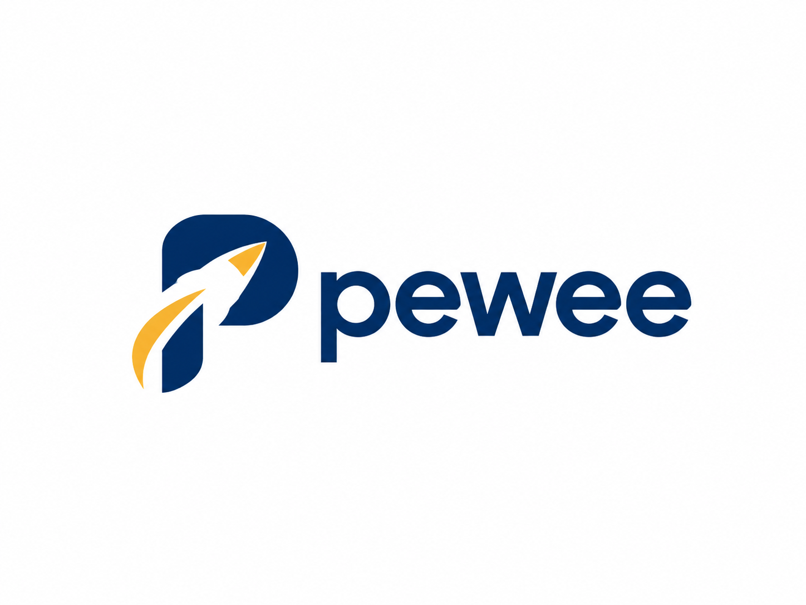

<p align="center">
  
</p>

<p align="center">
  <em>
    "PEWEE reactors are smaller than their NERVA and PHOEBUS counterparts<br>
    and, therefore, can be built and tested in less time and at lower cost."<br>--United States Aeronautics and Space Activities, 1968
  </em>
</p>

# Pewee

a lightweight CUDA kernel library for W4A16 (INT4 weights × FP16 activations) linear operations in PyTorch.

It provides fused weight dequantization and matrix computation through custom CUDA GEMV kernels and CuTe-based Tensor Core GEMM kernels, avoiding full weight dequantization into an intermediate matrix during accelerated execution.

Inspired by [AWQ](https://github.com/mit-han-lab/llm-awq) and [MiLo](https://github.com/Supercomputing-System-AI-Lab/MiLo), Pewee focuses on efficient low-bit computation, GPU kernel optimization, and reproducible performance evaluation.

## Key Features

- **W4A16 Quantization** — 4-bit packed weights with FP16 activations, supporting group-wise asymmetric quantization.
- **Fused CUDA Kernels** — On-the-fly INT4 unpacking and dequantization, without materializing a full dequantized weight matrix in the optimized GPU paths.
- **Optimized GEMV & GEMM** — Warp-level CUDA GEMV and CuTe-based Tensor Core GEMM for different workloads.
- **PyTorch Integration** — Installable C++/CUDA extension with a Python interface and automatic selection between supported execution paths.

## Installation

### Requirements

- Linux or Windows Subsystem for Linux (WSL2)
- NVIDIA GPU with CUDA support
- Python and CUDA-enabled PyTorch
- NVIDIA CUDA Toolkit (`nvcc`)
- C++20-compatible compiler
- NVIDIA CUTLASS/CuTe headers

The project has been developed and tested on the following configuration:

| Component | Environment |
|---|---|
| GPU | NVIDIA RTX 3050 Ti Laptop (SM 8.6) |
| OS | Ubuntu on WSL2 |
| CUDA Toolkit | 13.3 |
| PyTorch | 2.14.0+cu130 |
| Precision | W4A16 (INT4 / FP16) |

Other GPU architectures and software configurations have not yet been fully validated.

### Build from Source

First, install a CUDA-enabled version of PyTorch compatible with your CUDA toolchain.

Make sure the NVIDIA CUTLASS headers are available and their include directory is configured for the build. In particular, the compiler must be able to locate `cute/tensor.hpp`.

From the project root, build and install the CUDA extension:

```bash
python -m pip install -e . --no-build-isolation
```

To verify that the Python package can be imported:

```bash
python -c "import lowbitlinear; print(lowbitlinear.__file__)"
```


**Note:** Building from source requires a compatible CUDA toolchain and the CUTLASS/CuTe headers. Installation and correctness have been exercised in the development environment; clean-environment installation and cross-GPU compatibility still require further validation.

## Quick Start

Pewee provides a simple PyTorch interface for W4A16 quantized linear operations.

```python
import torch
from lowbitlinear import QuantizedLinear

# Create a linear layer with INT4 quantized weights
weight = torch.randn(128, 256, device="cuda", dtype=torch.float16)
layer = QuantizedLinear.from_float(weight)

# Single-token inference (GEMV)
x = torch.randn(1, 256, device="cuda", dtype=torch.float16)
y = layer(x)
print(y.shape)  # torch.Size([1, 128])

# Batched inference (GEMM)
x = torch.randn(32, 256, device="cuda", dtype=torch.float16)
y = layer(x)
print(y.shape)  # torch.Size([32, 128])
```

The `QuantizedLinear` module automatically selects the supported GEMV, GEMM, or reference execution path based on the input configuration.

Weights are quantized once during `from_float()`, while the optimized CUDA kernels perform INT4 unpacking and dequantization on the fly.

**Note:** The current implementation focuses on FP16 inference with INT4 weights and group-wise quantization (`group_size=64` for the optimized CUDA paths).

## Performance

### Kernel Benchmark

| Linear | Native FP16 | Unfused W4A16 | Pewee Fused | Speedup vs Unfused |
|---|---:|---:|---:|---:|
| QKV | 160.382 | 9186.432 | 303.680 | 30.25x |
| O | 81.472 | 6136.952 | 244.992 | 25.05x |
| Gate/Up | 478.452 | 39823.744 | 1180.358 | 33.74x |
| Down | 257.024 | 18669.248 | 721.664 | 25.87x |

### End-to-End Inference

Qwen3-8B | NVIDIA A10 | Batch=1 | TP=1 | Eager mode | 64 output tokens | Median latency (ms, lower is better)

| Input / Output | Mode | TTFT (ms) | TPOT (ms) | E2E (ms) |
|---|---|---:|---:|---:|
| 32 / 64 | Native FP16 | 44.626 | 38.519 | 2471.572 |
| 32 / 64 | Pewee W4A16 | 163.521 | 44.697 | 2979.389 |
| 128 / 64 | Native FP16 | 43.984 | 38.198 | 2450.429 |
| 128 / 64 | Pewee W4A16 | 109.802 | 44.795 | 2932.329 |
| 192 / 64 | Native FP16 | 59.453 | 39.010 | 2516.262 |
| 192 / 64 | Pewee W4A16 | 158.251 | 44.392 | 2954.770 |

### Memory Efficiency

| Metric | FP16 | Pewee W4A16 |
|---|---:|---:|
| Model weight storage | 15.256 GiB | **6.362 GiB** |
| GPU memory allocated after initialization | 15.356 GiB | **6.475 GiB** |
| Peak allocated during inference | 15.370 GiB | **6.489 GiB** |
| Peak allocated (loading through inference) | 16.438 GiB | **7.609 GiB** |
| KV Cache | 0.070 GiB | 0.070 GiB |

Pewee reduces Qwen3-8B model weight storage by **58.30%**, from 15.256 GiB to 6.362 GiB, saving approximately 8.89 GiB.

### Environment

| Component | Configuration |
|---|---|
| GPU | NVIDIA A10 (SM 8.6, 150 W power cap) |
| NVIDIA Driver | 550.163.01 |
| CUDA | 12.8 |
| PyTorch | `2.7.0a0+7c8ec84dab.nv25.03` |
| Model | Qwen3-8B |
| Inference Framework | nano-vLLM |

## Implementation

### Quantization

Pewee uses **group-wise asymmetric INT4 weight quantization** with a group size of 64.

Each group stores quantized 4-bit weights along with FP32 scales and INT32 zero points. Eight INT4 values are packed into a single 32-bit integer.

Weights are reconstructed as:

```text
w = (q - zero) * scale
```

The packed weight format is:

| Tensor | Shape | Dtype |
|---|---|---|
| Activations | `[M, K]` | FP16 |
| Packed weights | `[N, ceil(K/8)]` | INT32 |
| Scales | `[N, ceil(K/64)]` | FP32 |
| Zero points | `[N, ceil(K/64)]` | INT32 |
| Output | `[M, N]` | FP16 |

The kernels perform dequantization during computation, avoiding a separate full-weight dequantization pass.

### CUDA Kernels

Pewee provides two optimized execution paths:

**GEMV — Warp-level CUDA**

Designed for single-row inference workloads. Threads cooperatively unpack INT4 weights, apply group-wise dequantization, and perform warp-level reductions.

**GEMM — CuTe Tensor Core**

Implemented using NVIDIA CUTLASS/CuTe, with tiled matrix multiplication and Tensor Core acceleration.

The GEMM kernel incorporates:

- Coalesced global memory access and shared memory tiling.
- Fused INT4 unpacking and dequantization.
- Reuse of packed weights and quantization metadata.
- FP16 Tensor Core multiplication with FP32 accumulation.
- Boundary masking for irregular matrix dimensions.

Dequantized weights are converted to FP16 within the kernel before Tensor Core computation, without materializing the complete weight matrix.

### PyTorch Integration

Pewee is built as a PyTorch C++/CUDA extension using `CUDAExtension` and custom operator registration.

The `QuantizedLinear` module provides a unified interface with three execution paths:

| Path | Usage |
|---|---|
| CUDA GEMV | Supported single-row inputs |
| CuTe GEMM | Supported CUDA matrix workloads |
| Reference | CPU or unsupported optimized configurations |

Dispatch is based on input properties and kernel compatibility rather than hardware-specific benchmark thresholds.

The optimized CUDA implementation is currently focused on **W4A16 forward inference**, with `group_size=64`.

## Testing

Pewee includes correctness tests covering INT4 quantization, CUDA GEMV, CuTe GEMM, and the PyTorch interface.

Run the complete test suite:

```bash
python -m pytest tests/ -v
```

Or run individual tests:

```bash
# Quantization correctness
python -m pytest tests/test_quantization.py -v

# CUDA GEMV
python -m pytest tests/test_cuda_gemv.py -v

# CuTe GEMM
python -m pytest tests/test_cute_w4a16_gemm.py -v

# API dispatch
python -m pytest tests/test_api_dispatch.py -v
```

The tests validate numerical correctness against reference implementations, including supported input shapes and boundary conditions.

## Benchmarking

Pewee provides reproducible microbenchmarks for evaluating W4A16 CUDA kernel performance.

Run the benchmark:

```bash
python benchmarks/bench_w4a16.py
```

The benchmark is intended to evaluate GEMV and GEMM performance across different matrix dimensions, with latency measurements and baseline comparisons.

For GPU profiling:

```bash
# CuTe GEMM
python benchmarks/profile_w4a16.py --operator gemm --shape MxNxK

# Warp Vec GEMV
python benchmarks/profile_w4a16.py --operator gemv --shape MxNxK
```

See [benchmarks/README.md](benchmarks/README.md) for detailed benchmark configurations, measurement methodology, and profiling instructions.

## Limitations

Pewee currently has the following limitations:

- **Inference Only:** Supports forward computation without backward propagation or gradient computation.
- **Limited Precision:** Optimized kernels currently support W4A16 (INT4 weights and FP16 activations) with a group size of 64. BF16 and other quantization formats are not supported.
- **GPU Compatibility:** Primarily developed and tested on NVIDIA Ampere SM86. Other GPU architectures have not been fully validated.

## References

Pewee is inspired by the following research and open-source projects:

- **[AWQ: Activation-aware Weight Quantization for On-Device LLM Compression and Acceleration](https://proceedings.mlsys.org/paper_files/paper/2024/hash/42a452cbafa9dd64e9ba4aa95cc1ef21-Abstract-Conference.html)** — Lin et al., MLSys 2024.  
  [GitHub](https://github.com/mit-han-lab/llm-awq)

- **[MiLo: Efficient Quantized MoE Inference with Mixture of Low-Rank Compensators](https://arxiv.org/abs/2504.02658)** — Huang et al., MLSys 2025.  
  [GitHub](https://github.com/Supercomputing-System-AI-Lab/MiLo)

Pewee is an independent implementation and does not reproduce the complete quantization algorithms or inference systems of AWQ or MiLo.

## License

Pewee is licensed under the MIT License.
See [LICENSE](LICENSE) for details.